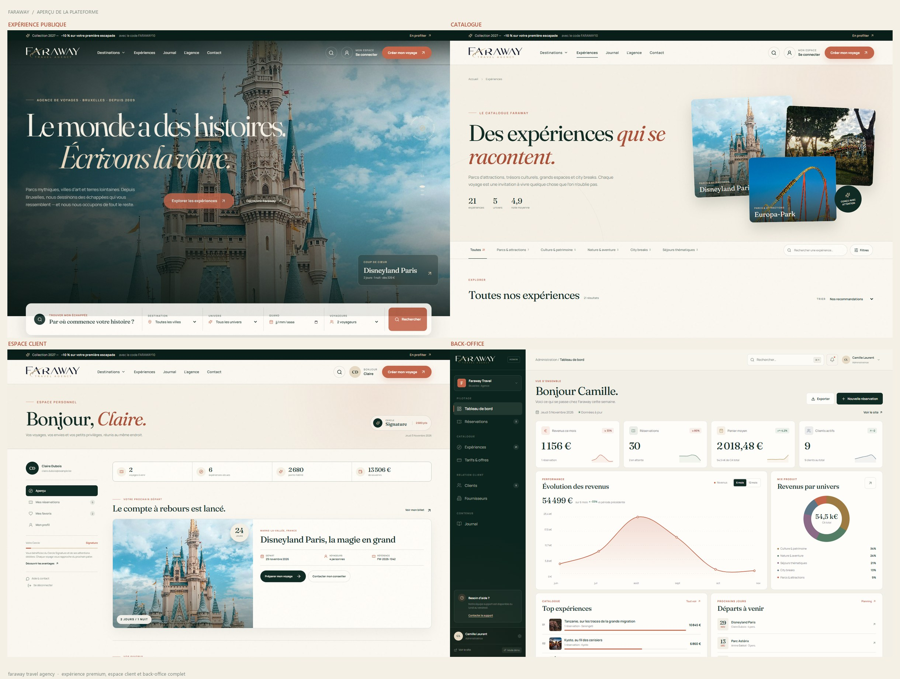

# Faraway Travel Agency

<p align="center">
  
</p>

<p align="center">
  Plateforme e-commerce de voyage premium — parcs, culture, nature et séjours thématiques.<br/>
  <a href="http://127.0.0.1:4173"><strong>Voir l'aperçu local</strong></a>
</p>




## Lancer le projet

```bash
npm install
npm run dev
```

Le site est disponible sur `http://127.0.0.1:4173`.

Build de production :

```bash
npm run build
npm run preview
```

## Accès de démonstration

| Espace | Accès |
| --- | --- |
| Espace client | `claire.dubois@example.be` — mot de passe `faraway` |
| Back-office | [`/admin`](http://127.0.0.1:4173/admin) — accès direct en mode démo |
| Compte de test | Le bouton « Utiliser le compte démo » préremplit les identifiants |

Aucun paiement réel n’est effectué. Les réservations, clients, produits, tarifs, fournisseurs et articles sont persistés dans le `localStorage` du navigateur. Pour réinitialiser la démo, videz le stockage local du site.

## Fonctionnalités livrées

### Expérience publique
- Accueil immersif avec carrousel éditorial, recherche multi-critères, univers, sélection d’expériences, récits de voyage et preuve sociale.
- Catalogue filtrable par univers, destination, budget, durée et recherche libre, avec tri et états vides.
- Fiches expériences complètes : galerie plein écran, itinéraire, inclus/non inclus, informations pratiques, avis, partenaire local et réservation sticky.
- Tunnel de réservation en deux étapes : coordonnées, voyage, code promo, paiement simulé Bancontact / carte / virement, confirmation et billet téléchargeable au format calendrier (`.ics`).
- Espace client : tableau de bord, prochain départ, réservations, favoris, profil, préférences et gestion du mot de passe.
- Journal : articles, catégories, partage, lecture et contenus associés.
- Pages agence et contact avec formulaire, carte stylisée, FAQ et engagements.

### Back-office
- Tableau de bord : revenus, réservations, panier moyen, clients actifs, graphique de performance, répartition par univers, top expériences, départs à venir, export CSV.
- Réservations : recherche, filtres, pagination, création manuelle, changement de statut, notes internes et fiche détaillée.
- Expériences : création et édition complète, visuels, tarifs, stock, fournisseur, publication, duplication et suppression protégée.
- Clients : base clients, profils, préférences, notes internes, historique et gestion des accès.
- Tarifs & offres : grille de prix, calcul de marge, édition des tarifs, codes promotionnels et activation.
- Fournisseurs : répertoire, contacts, statuts, performance et rattachement aux expériences.
- Journal : rédaction, publication, brouillons, édition et suppression des articles.
- Recherche globale (`Ctrl/Cmd + K`), notifications, navigation responsive et export CSV sur les principales listes.

## Stack technique

- **React 19 + TypeScript + Vite**
- **React Router** pour la navigation
- **Framer Motion** pour les transitions
- **Lucide** pour l’iconographie
- CSS sur mesure, polices auto-hébergées (`Fraunces` et `Manrope`)
- État applicatif centralisé et persistance locale via `StoreContext`

## Structure

```text
src/
  admin/             Back-office, composants et utilitaires
  components/        Header, footer, cartes, recherche, UI partagée
  data/data.ts       Contenu de démonstration (expériences, clients, réservations…)
  lib/utils.ts       Formatage, prix, dates et helpers de statut
  pages/             Pages publiques
  store/             Contexte global et persistance localStorage
  styles/            Design system, site public et back-office
public/
  images/            Visuels optimisés et logo officiel (images/brand)
  fonts/             Polices auto-hébergées
  favicon*.png       Favicon et icônes d’application
```

## Crédits

Photographies : Unsplash et Pexels (licences libres), et Wikimedia Commons — Bruges par Ank Kumar, CC BY-SA 4.0. Les contenus, prix, avis et références de l’agence sont fictifs et servent uniquement à la démonstration.

Logo, monogramme et favicon : identité visuelle Faraway fournie par le client.
